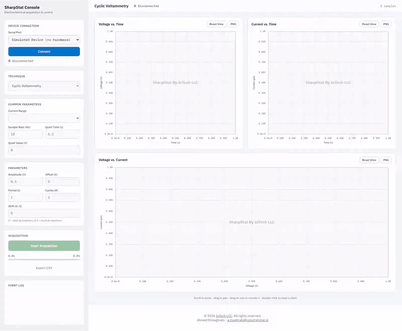
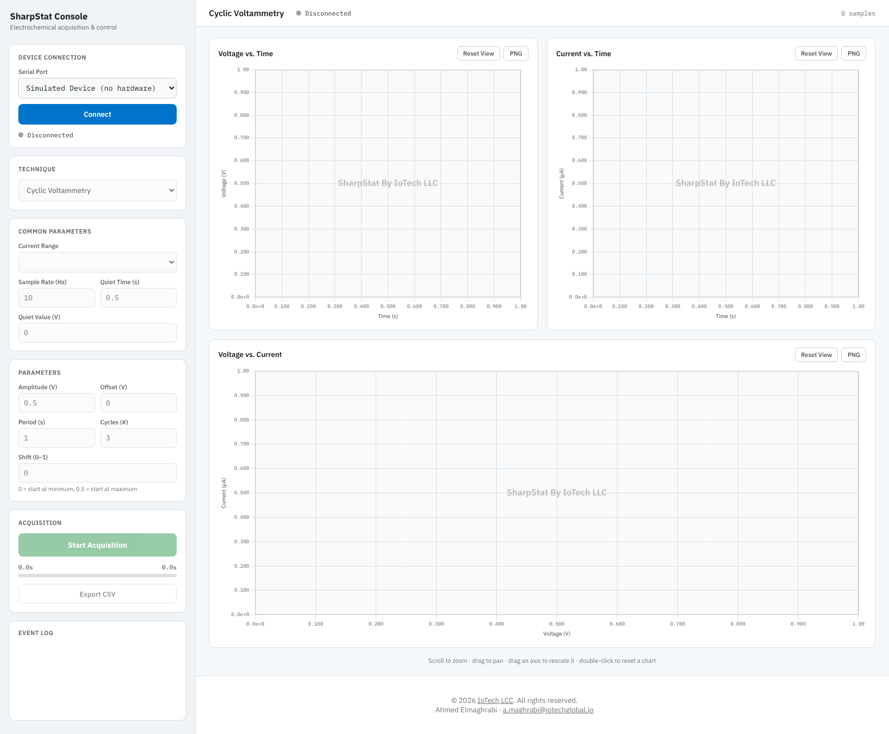
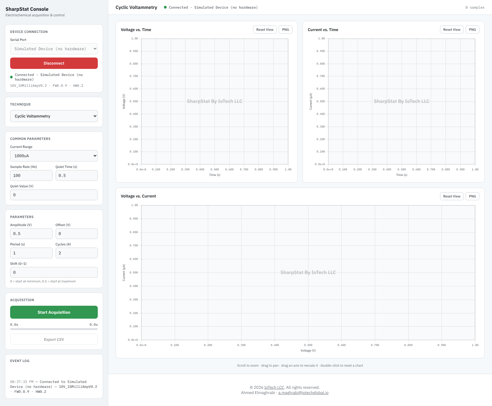
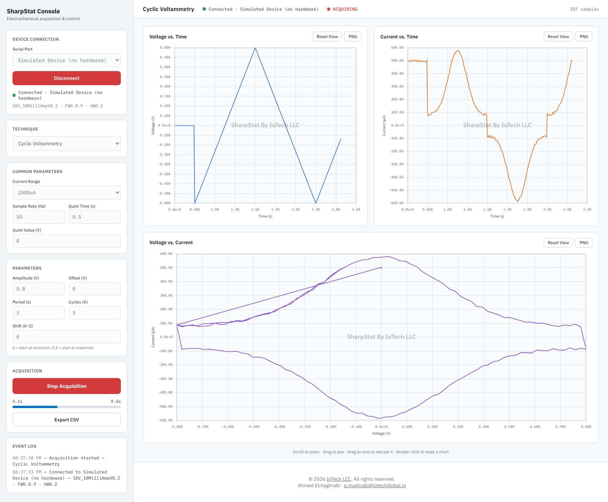
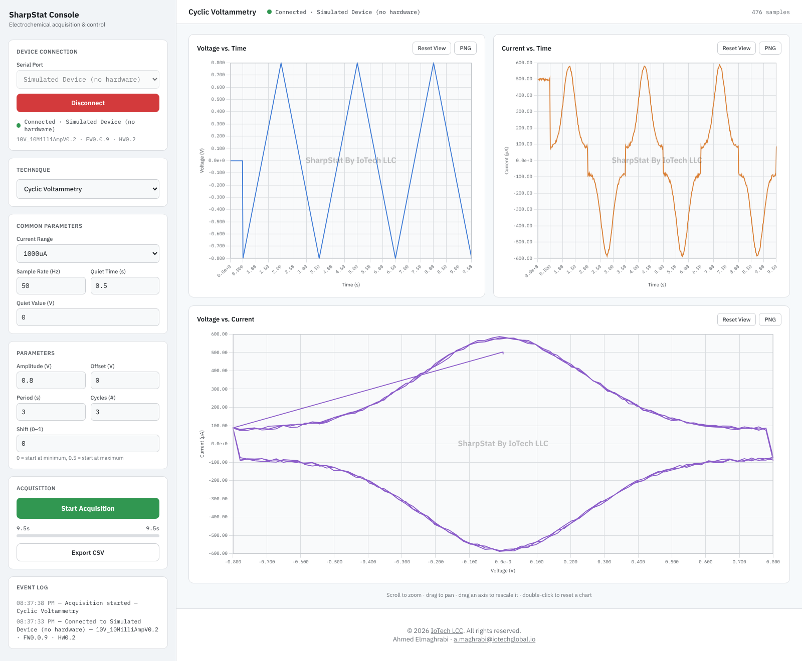
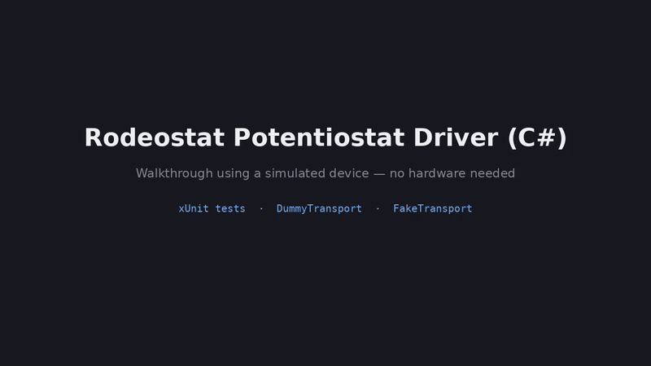
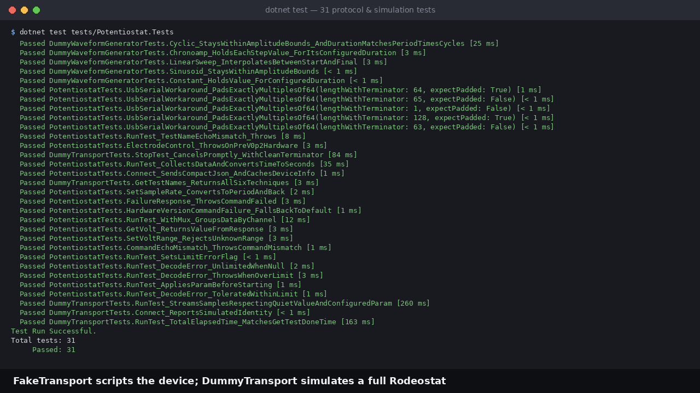
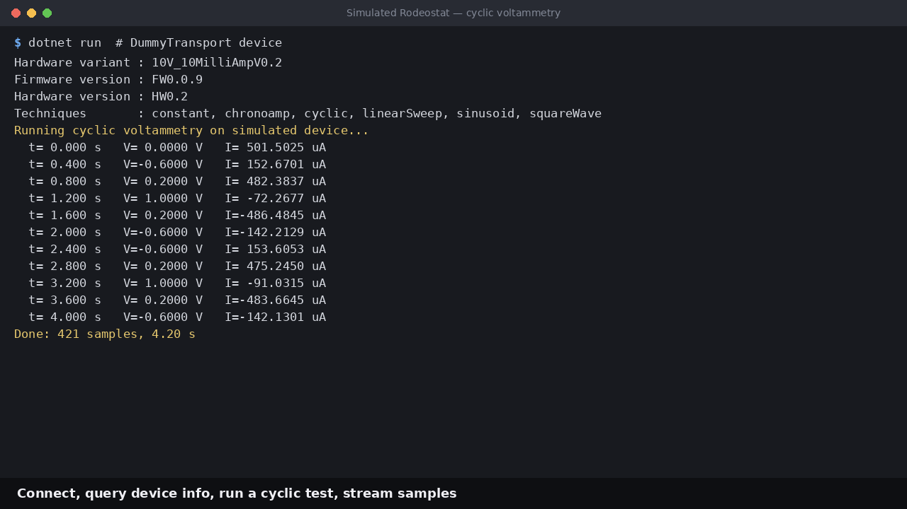
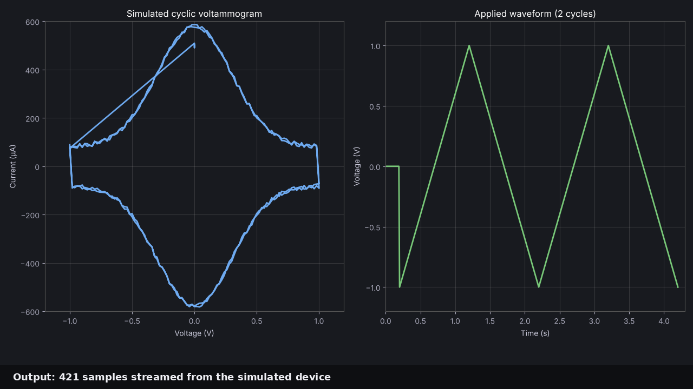

# Potentiostat (C#)

C# port of the Python driver for the [IO Rodeo Rodeostat](https://iorodeo.com/)
open source potentiostat (`software/python/potentiostat`). Targets .NET 8 and
communicates with the device over newline-delimited JSON at 115200 baud using
`System.IO.Ports`.

## Walkthrough

Everything below runs against the built-in simulated device, so no hardware is needed.

### Web GUI (Potentiostat Console)





*1. Start screen: pick a serial port (the simulated device is always listed) and connect.*



*2. Connected: the device variant, firmware and hardware versions are shown in the sidebar.*


*3. Choose a technique (here Cyclic Voltammetry) and set its parameters and the sample rate.*



*4. Live acquisition: samples stream into the voltage-time, current-time and voltage-current charts while a progress bar tracks the run.*



*5. Finished run: the full cyclic voltammogram is ready to zoom, export as PNG, or save as CSV.*

### Library tests and simulated device (terminal)





*1. `dotnet test`: the protocol and simulation tests all pass against the in-memory fake and simulated transports.*



*2. Connecting to the simulated Rodeostat, listing its techniques and streaming a cyclic run.*



*3. The simulated cyclic voltammogram and applied waveform from the streamed samples.*

## Layout

- `src/Potentiostat` — **deprecated**, the original driver library
  (`IoRodeo.Potentiostat` namespace); kept for reference/rollback only, no
  longer referenced by `Potentiostat.Web`/`Potentiostat.Demo`
- `src/Potentiostat.Web` — self-hosted ASP.NET Core GUI ("Potentiostat Console"):
  opens a browser to connect, configure, and run a live acquisition
- `examples/Potentiostat.Demo` — console demo: prints device info, runs a test
  with a progress bar, optionally writes a CSV
- `tests/Potentiostat.Tests` — xUnit protocol tests against an in-memory fake
  transport (no hardware needed); still tests the deprecated `src/Potentiostat`
  library

`Potentiostat.Web` and `Potentiostat.Demo` build against the external
`SharpStatDriver` project (`IoRodeo.SharpStatDriver` namespace) in a sibling
repo at `D:\EJUST\potentiostat\software\SharpStatDriver`, rather than
`src/Potentiostat` above — `SharpStatDriver` is an API-compatible port, so the
usage sample below applies to both.
- `tests/Potentiostat.Web.Tests` — xUnit tests for `Potentiostat.Web` (unit
  conversions, param packing; no hardware needed)
- `installer/` — Inno Setup script for the Windows installer
- `scripts/` — release automation (`publish-release.ps1`)

## Usage

```csharp
using IoRodeo.Potentiostat;
using System.Text.Json.Nodes;

await using var pstat = new Potentiostat("COM3");
await pstat.ConnectAsync();

Console.WriteLine(pstat.HardwareVariant);   // e.g. 10V_microAmpV0.2
await pstat.SetCurrRangeAsync(CurrRanges.Range100uA);

var param = new JsonObject
{
    ["quietValue"] = 0.0,
    ["quietTime"] = 1000,
    ["amplitude"] = 1.0,
    ["offset"] = 0.0,
    ["period"] = 2000,
    ["numCycles"] = 3,
    ["shift"] = 0.0,
};

pstat.SampleReceived += (_, e) =>
    Console.WriteLine($"{e.Sample.TimeSeconds:0.000} s  {e.Sample.Volt:0.0000} V  {e.Sample.Curr:0.0000} uA");

var result = await pstat.RunTestAsync("cyclic", param);
// result.Times (s), result.Volts (V), result.Currents (uA)
```

Run the demo:

```
dotnet run --project examples/Potentiostat.Demo -- COM3 cyclic data.csv
```

Run the web GUI:

```
dotnet run --project src/Potentiostat.Web
```

Build and test (whole solution):

```
dotnet build
dotnet test
```

## Building, bundling, and releasing Potentiostat.Web

`Potentiostat.Web` is distributed as a Windows installer that bundles the .NET 8
runtime, so end users never need to install .NET separately — they just run the
installer and double-click the app from the Start Menu.

**Prerequisites** (build machine only, not needed by end users):
- .NET 8 SDK
- [Inno Setup 6](https://jrsoftware.org/isinfo.php) (`ISCC.exe`), for building the installer

### One-command release

```powershell
scripts/publish-release.ps1 -Version 1.0.0
```

This runs `dotnet publish` against the `win-x64-selfcontained` publish profile
(`src/Potentiostat.Web/Properties/PublishProfiles/win-x64-selfcontained.pubxml`),
which produces a self-contained, single-file `Potentiostat.Web.exe` — the .NET
runtime is embedded in the exe itself, alongside a `wwwroot/` folder and
`appsettings.json` (ASP.NET Core content files can't be embedded into the
single-file exe, so they travel next to it). The script then compiles
`installer/PotentiostatWeb.iss` with Inno Setup, producing:

```
release/PotentiostatConsole-Setup-1.0.0.exe
```

That one file is the release artifact — hand it to a user, they run it, it
installs to Program Files with a Start Menu shortcut and uninstaller, and
launching it opens the browser GUI automatically. If `ISCC.exe` isn't found
(on `PATH` or in its default install location), the script fails with a clear
message rather than silently skipping the installer step.

### Steps without the script

Useful for debugging a packaging problem in isolation:

```
dotnet publish src/Potentiostat.Web -c Release -r win-x64 --self-contained true -p:PublishProfile=win-x64-selfcontained -p:Version=1.0.0 -o publish/win-x64
ISCC.exe /DMyAppVersion=1.0.0 /DPublishDir=publish/win-x64 installer/PotentiostatWeb.iss
```

### Verifying a release

1. Confirm `publish/win-x64/Potentiostat.Web.exe` exists alongside `wwwroot/`
   and `appsettings.json` (self-contained output carries its own runtime —
   no dependency on a machine-wide .NET install).
2. Run `release/PotentiostatConsole-Setup-<version>.exe` on a machine without
   the .NET SDK/runtime installed to confirm it's genuinely self-contained.
3. From the installed Start Menu shortcut, confirm the browser opens
   automatically and (with a Rodeostat attached) a short test run completes —
   see the end-to-end checklist in
   [`src/Potentiostat.Web/PLAN.md`](src/Potentiostat.Web/PLAN.md#verification).

## Differences from the Python driver

- Async-first API: every device call is a `Task`-returning `...Async` method
  with `CancellationToken` support. Cancelling `RunTestAsync` sends `stopTest`
  to the device and drains the stream before throwing.
- Times are always returned in seconds (the Python `timeunit` option is gone;
  raw milliseconds are on each `Sample`).
- Streaming output is exposed via the `SampleReceived` event and
  `IProgress<TestProgress>` instead of callbacks/console printing; CSV writing
  is an opt-in helper (`CsvSampleWriter`) rather than built into `RunTest`.
  Pickle output has no equivalent.
- The 64-byte USB serial workaround for the Adafruit SAMD core bug is
  preserved (`SerialJsonTransport.ApplyUsbSerialWorkaround`).
